## 写到最前

看到隔壁音击兄弟非常激情踊跃的写着小逼儿流水账，实际上作为中二侧主办之一，虽然全程处于一个人员协调和黑奴的形态，对于比赛全程属于是隔岸观火，不过还是有着非常多的想法，于是我也来写写中二侧的一些小趣事，哈哈！

录播可能还得过几天才能发，先写点儿小几把话

## 赛前小故事

### 比赛哪来的

今年八月初左右，koko在群里问了嘴有没有人儿对举办比赛感兴趣的，然后我跟wsdifh在群里秒回了个来，于是，这么一个神奇的比赛就横空出世了

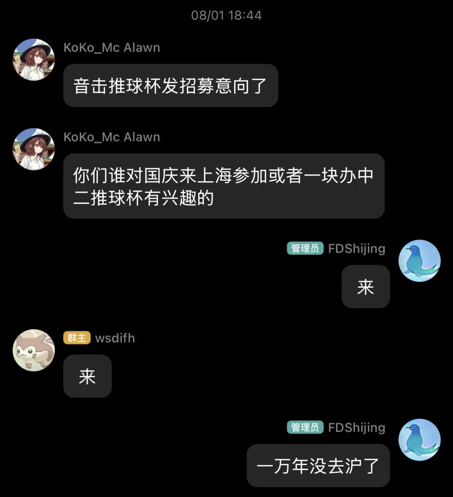

学

至于赛事具体筹备过程就不在这儿过多赘述了，有点不符合该专栏阖家欢乐的氛围，总之大伙都投入了相当多的精力与金钱，尤其是临近比赛的这几天，准备的水深火热程度不比隔壁危机合约刺激，总之大家都辛苦了！

### 团队赛选人

其实赛制发出来后我一直担心会不会没有人愿意报队长，不过在群里几次询问后[AferVentus_](https://space.bilibili.com/356428516)踊跃的报名了，极大地拯救了我们的推进进度，至于另一名队长，经过思虑再三，我们一致认为[小饼什么都知道](https://space.bilibili.com/164549161)具有卓越的小几把话编纂能力与组织能力，于是我便私信给他黑箱过来了，比较不巧的是他还报了隔壁wec的裁判，不过经过一番周旋还是翘了wec彩排来给推球干活了（实际上两边都干了巨多的活，泪目）

两支队伍都分别拉了个小群商议比赛排阵问题，大伙可以说是非常的积极，背赛之余的话题也是相当的热闹，总之我站中间看两边串也是非常的享受

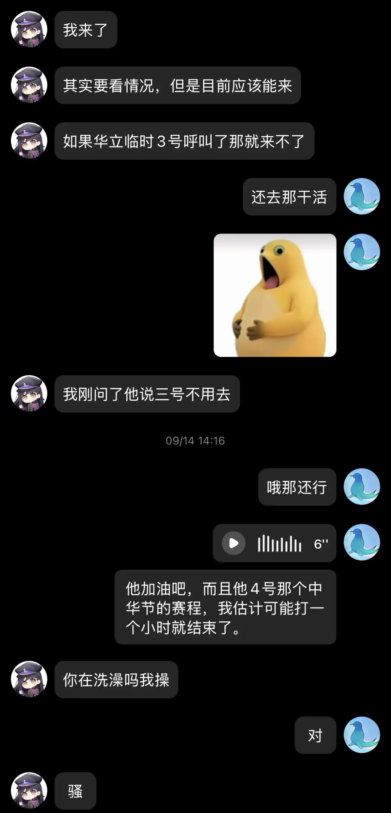

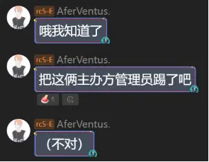

大声密谋

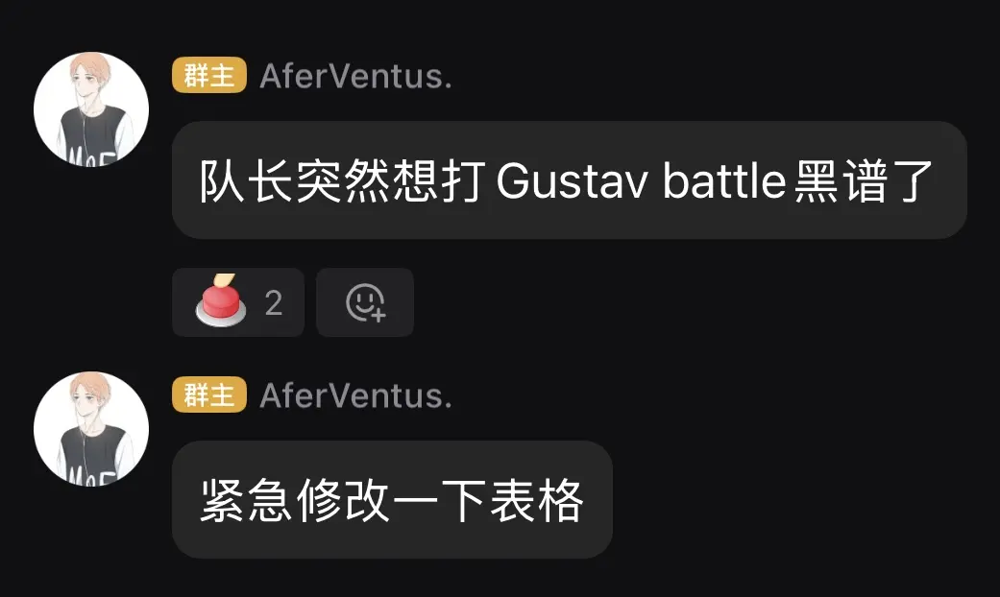

赛前趁选手们试机的时候简单认了下仅网上有些面熟的朋友，大家备战也非常积极，大伙到现场也进行了激情的选曲讨论与练习备战，可以看到非常多特色14+与风味13+轮番出现在现场，我偷偷玩儿的那一把就开了《狂乱》和SAMBISTA，都是我很久没开过的谱面，分数也比较美丽，可以说是对比赛谱面美味程度的一个预告

与此同时我们小饼队长对比赛的准备可以说是非常认真，直到开赛的前一个小时，还在勤奋的在隔壁beatmania iidx练习，可见其刻苦程度之深

---

## 常规团队赛

谁尽力，谁犯罪，谁的打法不团队

以防阅读专栏的小伙伴不清楚下边的部分赛制，简单补充说明一下常规赛的

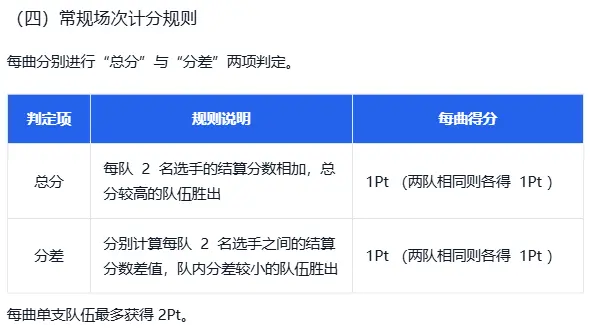

很简单对吧！

这个rc跟ex的命名真是隔壁玩儿4剋玩顺手了填进规划表忘改了，没有别的意思

学

### RC1 （只能选择 LEVEL 12+ / 13 / 13+ 的谱面）

•Servant of Love [MASTER 13+] (A队，选曲AzuR1dER & 星语）

比较冷门但非常具有科技厨房特色的神谱，比较偏手法向，很多左右交替的抬按设计，中间锁手12分纵连也比较初见杀，可以说是比较成功的厨力对策

•Schrecklicher Aufstand [EXPERT 13] (B队，选曲ananniu & GLB⭐XR）

非常出乎意料的选曲，直至现在我也没游玩过这个谱，赛前赛制特意把可以选红黄绿谱加上来，等的就是这个

毫不意外地也是成功对策上了

### RC2 （只能选择 LEVEL 13 / 13+ / 14 的谱面）

•REL0VE REL1VE [MASTER 13+] (A队，选曲jiffly cat & Flosriel）

整体比较规整平a的13.9，对键盘稳定性进行一个小考，歌比较小众平时也没啥人关注，对于四位选手来说应该都不算是痛点

•Blessed [MASTER 13+] (B队，选曲XGN-72 & 凌一水）

6666666666666，前半非常多手指开发和手臂穿模配置，结尾很多大键保护纵连以及tidal wave配置，总之不熟悉这谱的初见一定会被惊的下巴掉下来，不过看起来两边发挥都还可以

靠极低分差扳回局势还是有点变态了

### RC3 （只能选择 LEVEL 13+ / 14 / 14+ 的谱面）

请输入文本

发出来的时候我还不知道会发生什么

•Grievous Lady [MASTER 14+] (A队，选曲Samuel & Lemuen）

非常吃硬底力基本功的谱面，不过歌曲超级知名大伙应该都练的不少，打出来的分数也都比较好看

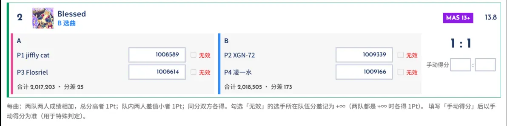

分差黏的有点死啊，旗鼓相当.jpg

•MEGATON BLAST [MASTER 14+] (B队，选曲bocchiQAQ & Voyager233）

这位更是超级综合大考，在14+这个难度下谱面可以说是全程高压，细节也不少，比赛环境下熟练度不高很容易出现崩盘（两边分确实也都不高）

### RC4 （只能选择 LEVEL 14 / 14+ / 15 的谱面）

•《本能》 ～ ReCoda [MASTER 14+] (A队，选曲Ecl05ioN & 槐绛）

选歌方向从这开始逐渐走向小众变态，先来一碗儿米粒锻炼下手指的灵活程度

我个人觉得这谱大部分段落硬按远比忍术稳定性高，只能说

你好

• 脳漿炸裂ガール [ULTIMA 15] (B队，选曲月升 & 鳳嘯）

你们这里谁是mizore头子，flick起火段的伤害音确实有点变态，虽然两分都稳稳拿下了但两边的分也是相当惨烈。。。

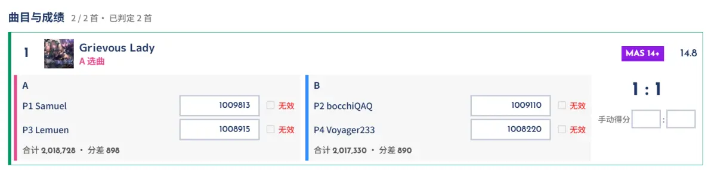

自爆大运

### RC5 （只能选择 ULTIMA 难度谱面）

我们坐在解说席的b老师偷偷下场打比赛了，由我们a队队长小饼简单替位解说一下，该偷偷反客为主黑屁了

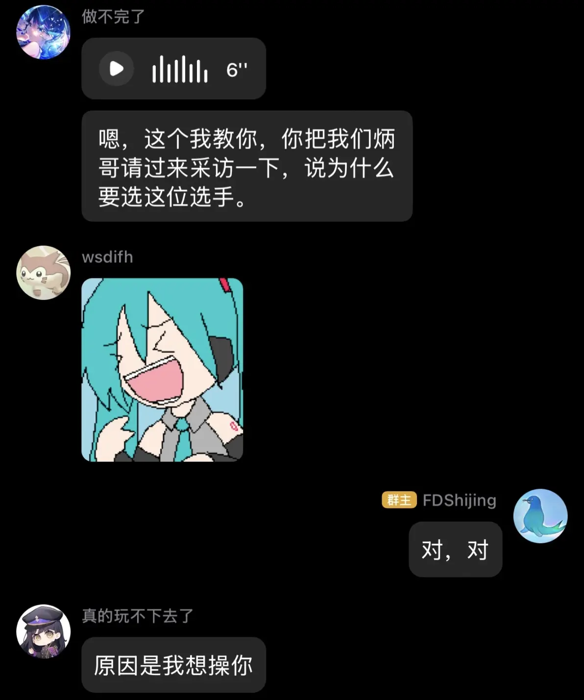

逼

•Vampire [ULTIMA 15] (A队，选曲113Jiang & Bywj）

我记得b老师特别会这歌，能在赛场上自信选出来可以说是毫不意外，其实在我的观点里这歌本质是个大号Genesis，对单手切的一个终极大考

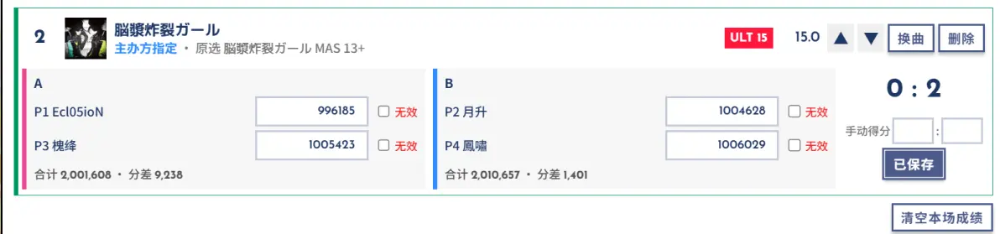

经典美味

•ジングルベル [ULTIMA 15] (B队，选曲AferVentus. & βγθφψωДё）

不幸的，刚好我们b老师没怎么练这个，虽然整体压力没有那么大，但作为烟花闪光弹类型谱面，着实需要一定的熟练度

据说选出来就是想让观众看到四个人手到处乱飞的感觉，好吧确实是这样

### RC6 （所有常规谱面均可选择）

赛前就觉得这种大范围，也是唯一能选15+的轮次两边会直接排大将，毫不意外地，这一轮确实也确实都上了硬菜，wec分会场来咯

•リ・フィクション・O [MASTER 15] (A队，选曲HooBBY & 黄逗豆owo）

铁锭虽然推分确实是不二之选，但在比赛里掏出来的体验就完全不一样了，黄逗豆是观众在赛前临时被拉进来打架的，没怎么排战术就求稳选了一个锭，两边分数都稳定浮在1008左右，还算比较稳定

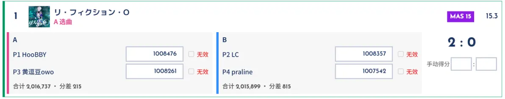

•Forsaken Tale [MASTER 15+] (B队，选曲LC & praline）

来硬的！LC这边直接致敬一波mr直接自选奶龙，这歌我记得黄逗豆刚好比较苦手然后B队刚好直接盲狙到了，而且赛前hoobby刚好在后边机连打出两10088我就知道这把分差肯定不会小

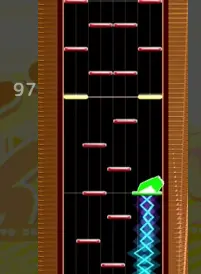

最后打了个2：2激情黏住，只能说比赛精彩之处就在这吧)

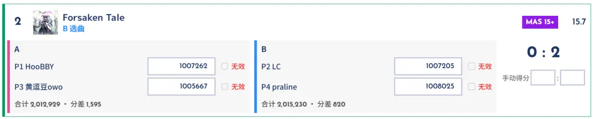

### RC7 （只能选择 LEVEL 12+ / 13 / 13+ 的谱面）

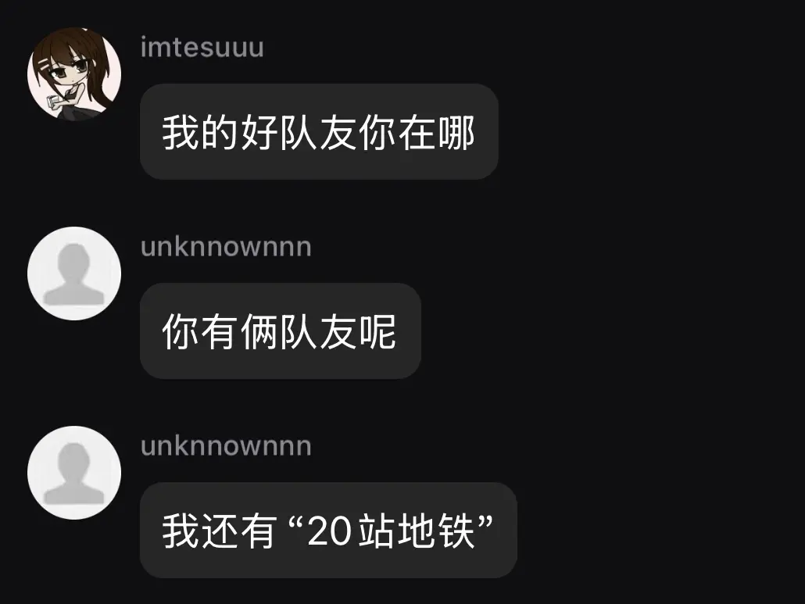

千里迢迢赶路中

•チュルリラ・チュルリラ・ダッダッダ！ [MASTER 13+] (A队，选曲 那一捧春 & lg2=0.3）

哈哈，反手跳拍来咯)

以防你不知道其实12+也有这种东西，只不过比这个慢

不过自选这边自己炸了比较可惜

•《理想》 ～ Cloudland [MASTER 12+] (B队，选曲imt & ．・：！：・．）

精灵记里最小的小歌，选出来应该是想拼一手稳定性，有几个衔接其实不熟的话蛮容易炸的

不过这现场理论是啥意思？我记得这理论难度在12+里算顶位的吧！)

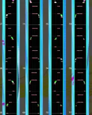

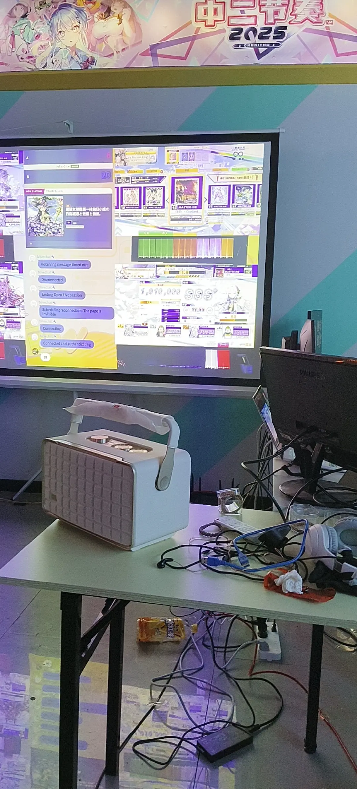

大会模式不能传记录有点太可惜

•男装女形表裏一体発狂小娘の詐称疑惑と苦悩と情熱。 [MASTER 13+] (A队，选曲 那一捧春 & lg2=0.3）

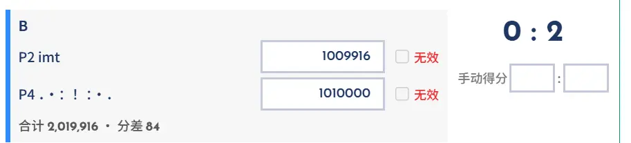

666666选的有点吊，结尾的超级单手纵连切在比赛中选择搓不搓蛮需要博弈的，不过一看自选这边直接打出了99aj的高分应该是自信正攻了

•玩具狂奏曲 -終焉- [EXPERT 13+] (B队，选曲imt & ．・：！：・．）

红谱里最高的山，自打4年前比赛我就天天被这谱对策，总之放现在都是阴完了的存在，赛前imt还在说没练这谱，然后这把一打两个1009950+。。。到底没练在哪？！！

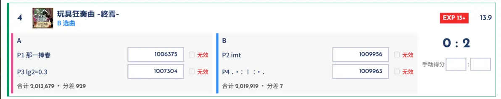

这个玩过这个谱的应该懂含金量，太变态了

### RC8 （只能选择 LEVEL 13+ / 14 / 14+ 的谱面）

选曲结果一出来大伙都释怀地笑了，impact往那一站跟座佛一样)

•トリスメギストス [MASTER 14] (A队，选曲炒饭 & 大猫）

赛前跟我报选歌的时候报了个luo男我反应了半天，原来是这小可爱玩意，低bpm保护大考的风味谱面，打各种分的难度可以说都是一个重量级

不过这选出来疑似对策自己队友了呀

有时候aj也是一种孤独

•ギガンティックO.T.N [MASTER 14] (B队，选曲Nefelibata & qdxf）

666666666666666依旧风味谱面，这初代谱虽然思路比较规整，但充斥着大量奇异的保护键盘摆型以及大陨石前置三连，以前推aj就给我折磨的不清

雅

•エテルニタス・ルドロジー [MASTER 13+] (A队，选曲炒饭 & 大猫）

变态东方13+来咯，中段有俩完全被air挡干净的红tap大划，后半也有很诡谲的5k接双压交互，不说不熟谱的了，即使刷过ajc比赛被开这玩意也得掂量掂量

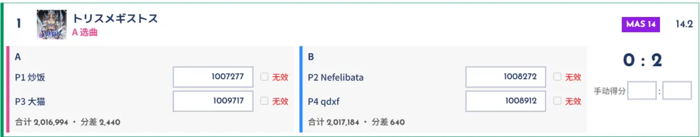

两边分都有点高

•IMPACT [MASTER 14+] (B队，选曲Nefelibata & qdxf）

你跟上面那三玩意一比纯良的像刚进大学的高考毕业生，真的

不过也正是因为容易掉以轻心，这歌其实很容易被低估，尤其是后半段的几段flick其实真的很容易掉，赛场上一紧张滑快点或者没到位一下绷一片的现象也不是不能出现（确实也出现了）

### RC9 （只能选择 LEVEL 14 / 14+ / 15 的谱面）

•旅星に渇く [MASTER 14+] (A队，选曲ICECUBE & Δ）

mizore一个比较小零食的一个14+，谱面属于备赛最容易被忽略的那一批，一个小小的信息差稳定性位置

•XL TECHNO -More Dance Remix- [MASTER 14+] (B队，选曲Beginning & ComicSans）

原来真有选这个的，而且还真给对策上了，oonp

这歌确实也比较适合这种赛制，一炸就能炸一片然后分差会特别变态

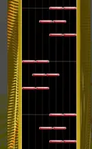

•其のエメラルドを見よ [MASTER 15] (A队，选曲ICECUBE & Δ）

我去这不是我们kop的lcq歌曲，完全的键盘考察，选出来应该就是纯拿键盘稳定性对赌了

•Megameteor [MASTER 15] (B队，选曲Beginning & ComicSans）

前年wec的热门曲目，谱面压迫感可以说是拉满，细节也非常多，保护dna对拍在比赛中的压迫感不言而喻

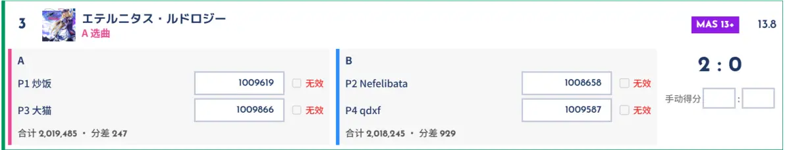

依旧以非常神奇的形式黏住了

### RC10 （所有常规谱面均可选择）

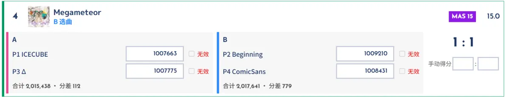

不是你这对吗这第二天wec一看这b组人员分布跟这把一模一样

•SKYSCRAPER [MASTER 13+] (A队，选曲DJHEALTH & COCOA.）

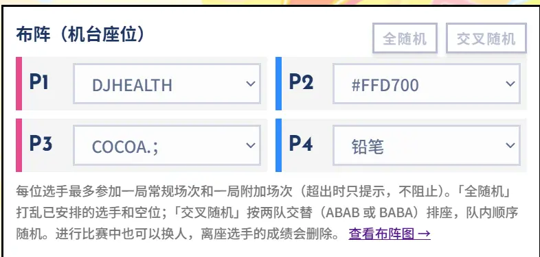

男人只哭三次，第一次FFD梦碎bassline（这届推球没看到有点可惜），第二次FFD梦碎skycraper，第三次FFD梦碎最后bla的slide

哈哈这歌一出来的时候我就笑了，一看ffd甚至游玩记录是0，我直接放下隔壁音击兄弟的蛋糕坐起来观看好吧

毫无疑问的在那个地方松了条子能，来点大伙爱看的东西

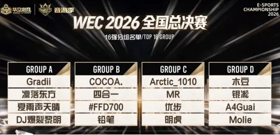

极致的视野，带给你的是

这个鹿头封面还是太变态了

•Rebellion [MASTER 15] (B队，选曲#FFD700 & 铅笔）

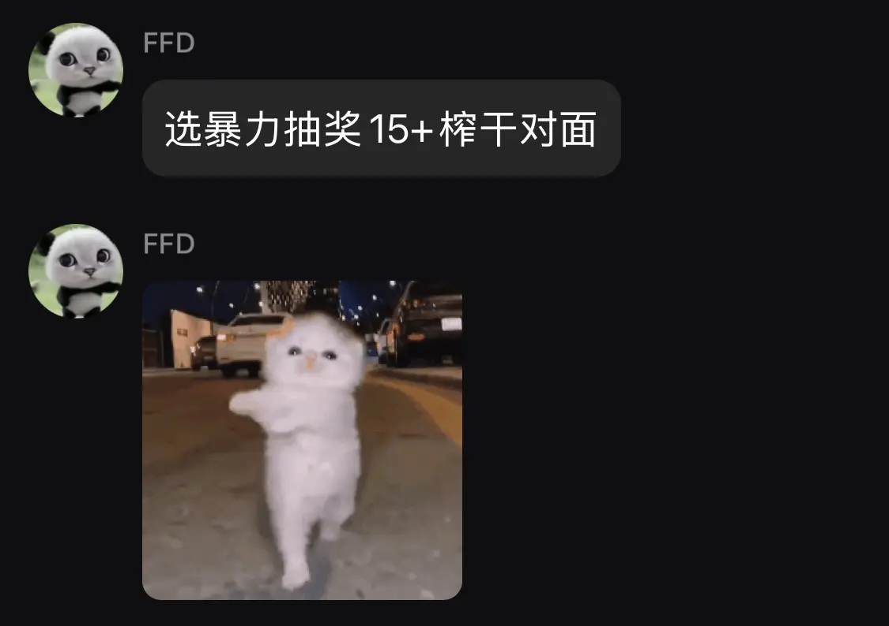

很经典的硬实力对轰，可惜没轰过

•Armageddon [MASTER 15] (A队，选曲DJHEALTH & COCOA.）

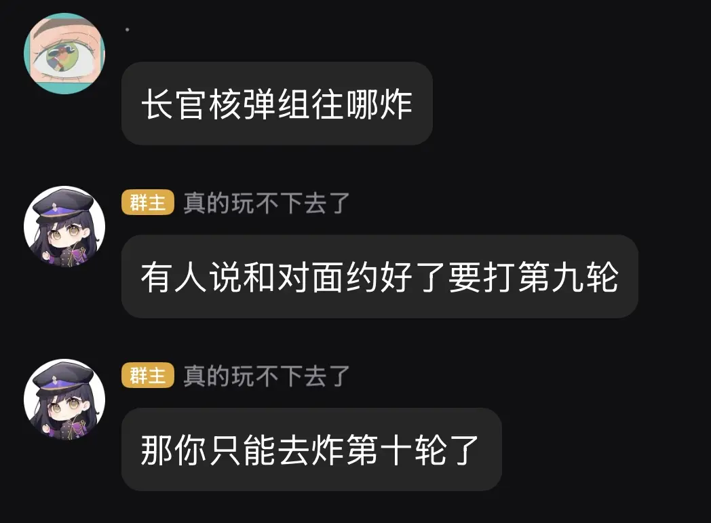

这坚果坐拥核弹3小aj的好成绩，加上蓝花也比较会，毫无疑问地炸穿了这把，吗

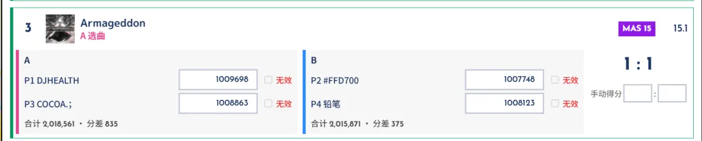

分差还是太戏剧了，神奇的赛制处处都有惊喜！

•宿星審判 [MASTER 15+] (B队，选曲#FFD700 & 铅笔）

比赛超级大热门抽奖选曲，不多提了，不过4个人里两现场鸟加的还是太变态了，硬实力对轰的看点还是给保留了下来，蛮精彩的

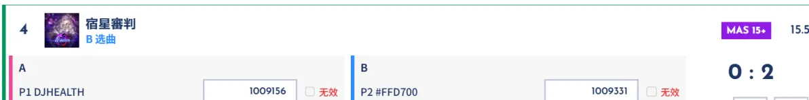

请输入文本

---

## 结语

以上就是常规赛的内容了，千言万语，非常感谢！

附加赛和其他内容准备留到下一篇了，之后再找个时间写，该上学了

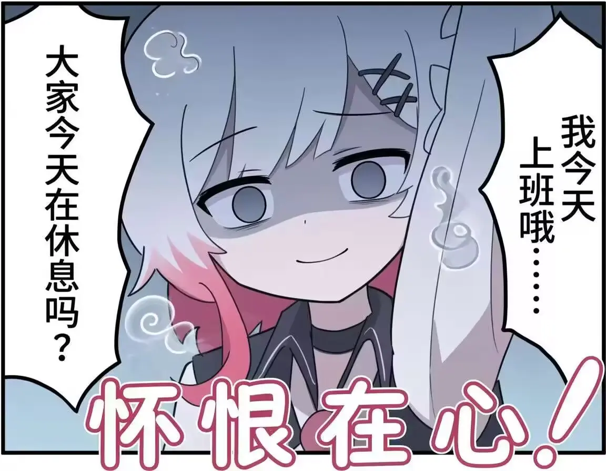

月

---

*原文：[推球杯Act.2杂记（上）](https://www.bilibili.com/opus/1256849044483866632) · 作者 FDShijing*
