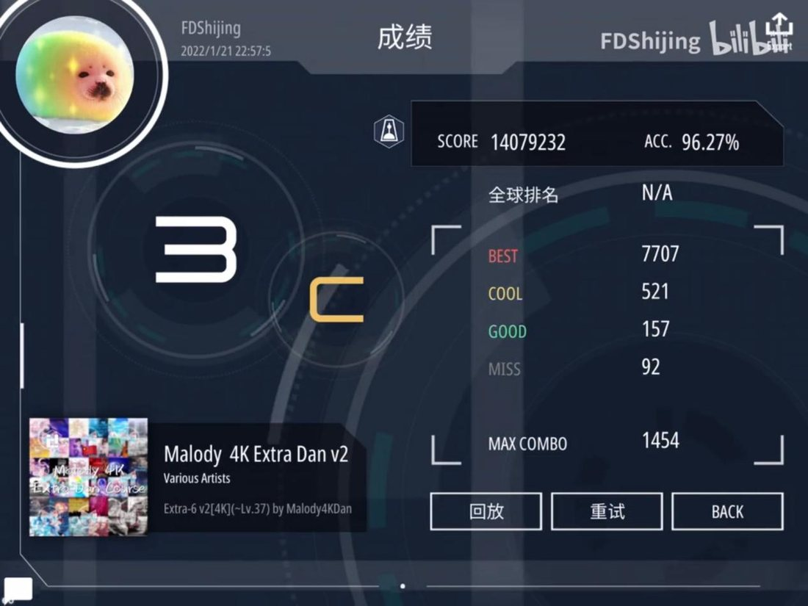
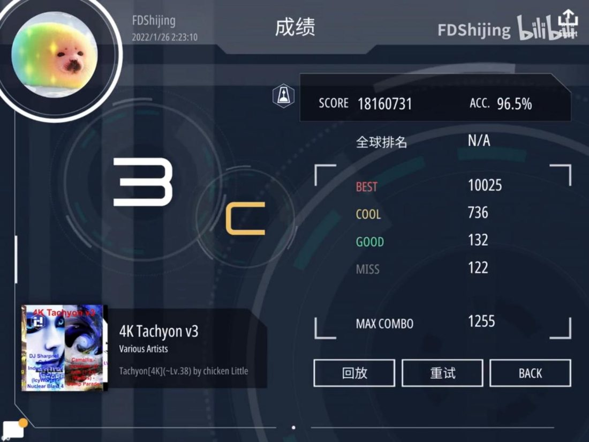
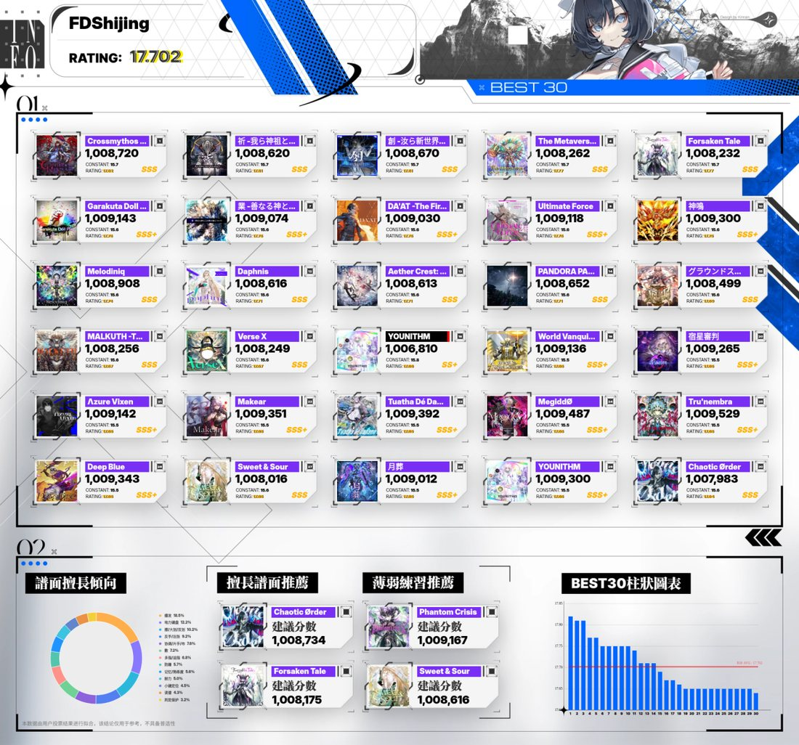
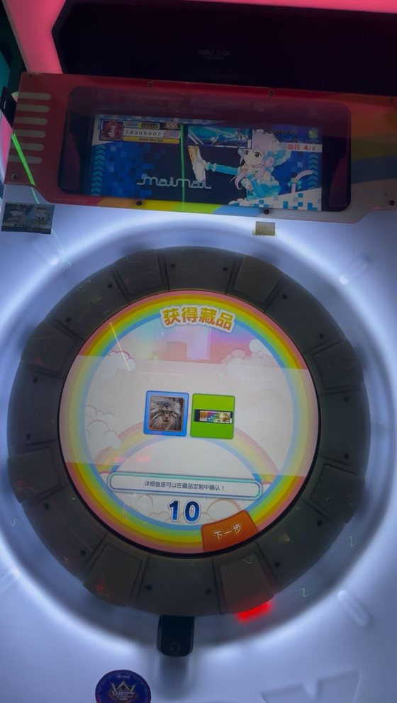
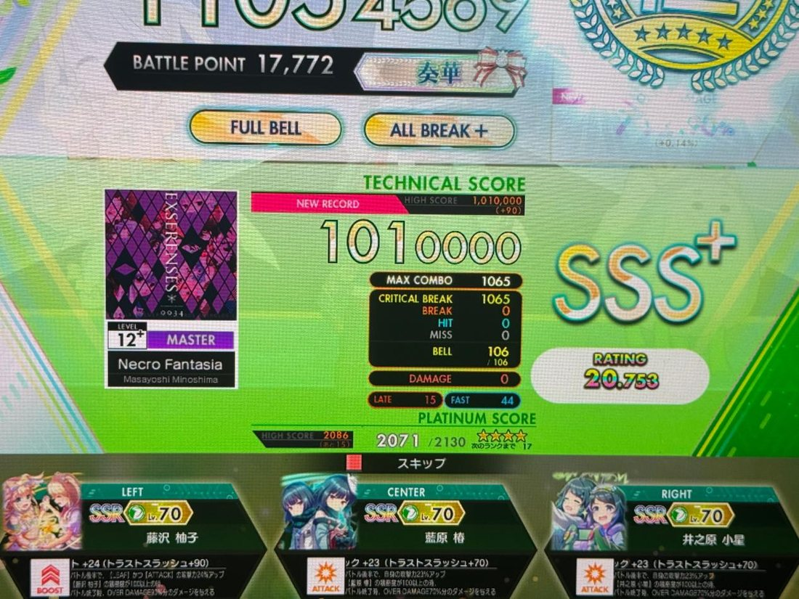

FDShijing / Baobao 两种称呼都可以，前者是脸滚键盘加无意识组装产物，后者取自我常用头像生物，头像真是海豹，不是鸟海狮鸽子等其他生物！！！

可能你会听到一些本名衍生出的一堆谐音组词或谐音梗，本人自己也玩所以大大方方玩

<h2>部分音乐游戏经历</h2>

<h3>Malody/osu mania</h3>

初中时期狂热游玩游戏，高中迫于学业压力淡坑，不过一直有陆陆续续地游玩，有个能大概游玩大部分谱面的能力总还是不赖，纯养生来的

Malody 4K Extra Dan v2 · ex6 v2

4K Tachyon v3

om稍微菜一点只过了个beta

<h3>写谱相关</h3>

虽然实力也就那样不过还是自认为写出了自己的东西的，除了ln基本上各种键型都稍微会写一点

<strong>偏好：</strong>dump，难度渐变递进，不严格对音依靠配置对结构重构造（其实就是画画）

前面两算基于我对音乐的理解大概摸出来的表达方法，后面那个算打日本街机游戏打的，纯原生om玩家可能不一定接受，也算是一个个人风格的体现吧

找我看谱其实大概得不到什么比较先进的意见，因为自己就比较基本功一坨纯靠意识感觉进行输出，除非类似完全第一次写谱的可能还能给点建设性意见，其他情况可能需要像给ai一样给点提示词专看某一方面我可能才有概率运作起来

osu 主页：<a href="https://osu.ppy.sh/users/22386239">https://osu.ppy.sh/users/22386239</a>

<h3>CHUNITHM</h3>

现主游玩的音乐游戏，在各个方面都非常对电波，大概会一直玩下去。

b站更新了超大量手元，希望能给大家带来一点帮助

国服2026虹底

<a href="https://www.bilibili.com/video/BV1yTUeBxEwp/">【中二节奏 2026/虹底纪念】フューチャー・イヴ 紫谱13+ AJC</a>

合表b30 17.7

合表 b30 · RATING 17.702

<strong>最喜欢的角色：</strong>レナ・イシュメイル，虽然玩的频率没那么高了，不过还是希望能养到200级

<h3>舞萌</h3>

第一个入坑的街机音乐游戏，虽然走了超级多的越级弯路不过还是非常享受游玩的过程，也是我第一次甚至说相当关键的社交面扩大的机遇，现在属于随性养生游玩阶段

目前真舞舞持有，rating w63

舞萌机台 · 获得藏品

<h3>节奏大师</h3>

很难不是入坑音游的契机，玩过比较长时间的自制，就以前有个叫蓝猫工作室的东西（这个懂得应该秒懂）

玩拇指起家的，小时候能搓暗流金字塔那些

<h3>音击</h3>

是现在有兴趣去继续了解的街机游戏，游戏本身质量真的很高，有非常之多意料之外的曲目出现，超级超级惊喜

手台玩家，大概初步目标是熟悉所有谱面与游戏系统

目前ra20.9，应该会起码尝试21.5吧，大概

Necro Fantasia MASTER 12+ 理论值

<h3>arcaea</h3>

3.0时代的双星/全曲包/全曲ex，已退坑

<h3>范式起源</h3>

abyssgazer版本的ra170，全曲包游玩，暂时非常久没有游玩，阻碍回坑一大原因是板子太菜

<h3>Vivid/stasis</h3>

虽然音游方面纯吃4k老本，不过非常喜欢里边的剧情，虽然一些优化做的很烂不过我还是依旧推荐上网云一波剧情，比较二次元合家欢，吗（叠甲：我不是那一个群体）

<h3>Project sekai</h3>

真皆30，ap过的最难的歌可能是紫bug，现账号已遗失遗憾离场

以前推mfy，非常喜欢二周年71期剧情，现已淡坑

<h3>Wacca</h3>

ra2635，在中二节奏未稼动国服之时成为舞萌大逼队代餐，因长沙已没有人类机器退坑（其实机台自身素质就很菜）

<h3>Bangdream</h3>

国服好像有个一两百级的账号

<h3>SDVX</h3>

完全刚入坑阶段，兴致来了会稍微玩点，抛开那个红大宇宙991只能打点16的鸟和鸟加

<h3>部分活动经历</h3>

<table>
<thead>
<tr><th>时间</th><th>经历</th></tr>
</thead>
<tbody>
<tr><td>2024</td><td>库璐璐音游嘉年华 摊主/staff</td></tr>
<tr><td>2024</td><td>WEC 中部预选赛 裁判</td></tr>
<tr><td>2025</td><td>WEC 中部预选赛 中二部门 解说</td></tr>
<tr><td>2026</td><td>推球杯 中二部门 Organizer</td></tr>
<tr><td>—</td><td>Malody MKTC 图池/v4 段位组</td></tr>
</tbody>
</table>

<h2>其他成分</h2>

<strong>泛二：</strong>轻音少女，CLANNAD，魔法少女小圆

其他部分阅历见b站这个部分应该是公开可见的，看的其实比较少，没有非常显著的角色厨，大家都是非常好的人！

<strong>二游：</strong>明日方舟，蔚蓝档案，现在只玩前面那个，比较没空二游轮着上班

<h2>Find me？</h2>

<ul>
<li><strong>QQ</strong>　3330308398</li>
<li><strong>个人QQ群</strong>　924289206　以前写谱专门建的</li>
<li><strong>Discord</strong>　FDShijing</li>
</ul>
