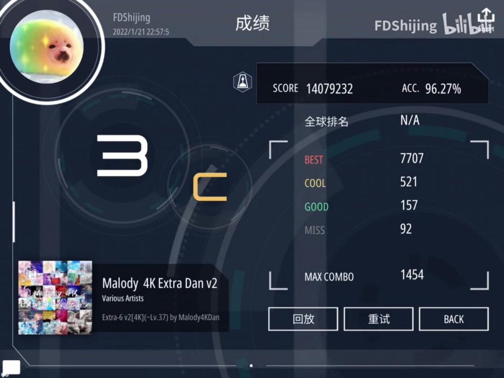
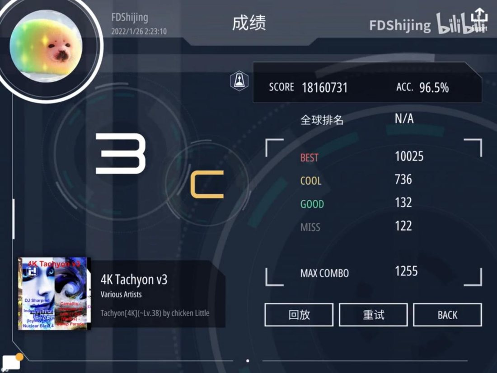
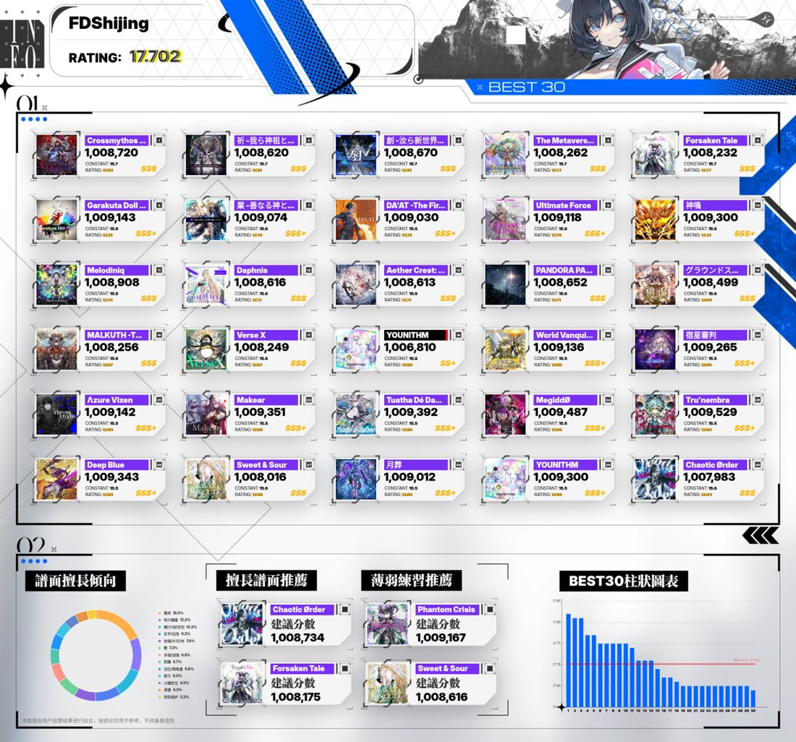
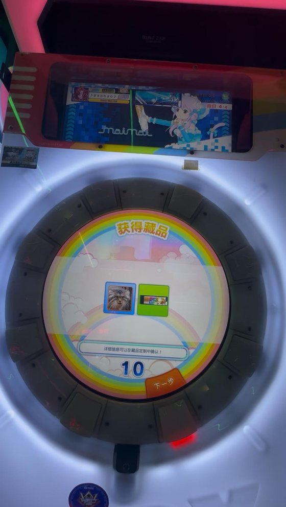

FDShijing / Baobao 两种称呼都可以，前者是脸滚键盘加无意识组装产物，后者取自我常用头像生物，头像真是海豹，不是鸟海狮鸽子等其他生物！！！

可能你会听到一些本名衍生出的一堆谐音组词或谐音梗，本人自己也玩所以大大方方玩

<h2>部分音乐游戏经历</h2>
<h3>Malody/osu mania</h3>

初中时期狂热游玩游戏，高中迫于学业压力淡坑，不过一直有陆陆续续地游玩，有个能大概游玩大部分谱面的能力总还是不赖，纯养生来的

Malody 4K Extra Dan v2 &middot; ex6 v2

4K Tachyon v3

om稍微菜一点只过了个beta

<h3>写谱相关</h3>

虽然实力也就那样不过还是自认为写出了自己的东西的，除了ln基本上各种键型都稍微会写一点

<strong>偏好：</strong>dump，难度渐变递进，不严格对音依靠配置对结构重构造（其实就是画画）

前面两算基于我对音乐的理解大概摸出来的表达方法，后面那个算打日本街机游戏打的，纯原生om玩家可能不一定接受，也算是一个个人风格的体现吧

找我看谱其实大概得不到什么比较先进的意见，因为自己就比较基本功一坨纯靠意识感觉进行输出，除非类似完全第一次写谱的可能还能给点建设性意见，其他情况可能需要像给ai一样给点提示词专看某一方面我可能才有概率运作起来

osu 主页：<a href="https://osu.ppy.sh/users/22386239">https://osu.ppy.sh/users/22386239</a>

<h3>CHUNITHM</h3>

现主游玩的音乐游戏，在各个方面都非常对电波，大概会一直玩下去。

b站更新了超大量手元，希望能给大家带来一点帮助

国服2026虹底

<a href="https://www.bilibili.com/video/BV1yTUeBxEwp/">【中二节奏 2026/虹底纪念】フューチャー・イヴ 紫谱13+ AJC</a>

合表b30 17.7

合表 b30 &middot; RATING 17.702

<strong>最喜欢的角色：</strong>レナ・イシュメイル，虽然玩的频率没那么高了，不过还是希望能养到200级

<h3>舞萌</h3>

第一个入坑的街机音乐游戏，虽然走了超级多的越级弯路不过还是非常享受游玩的过程，也是我第一次甚至说相当关键的社交面扩大的机遇，现在属于随性养生游玩阶段

目前真舞舞持有，rating w63

舞萌机台 &middot; 获得藏品

<h3>节奏大师</h3>

很难不是入坑音游的契机，玩过比较长时间的自制，就以前有个叫蓝猫工作室的东西（这个懂得应该秒懂）

玩拇指起家的，小时候能搓暗流金字塔那些

<h3>音击</h3>

是现在有兴趣去继续了解的街机游戏，游戏本身质量真的很高，有非常之多意料之外的曲目出现，超级超级惊喜

手台玩家，大概初步目标是熟悉所有谱面与游戏系统

目前ra20.9，应该会起码尝试21.5吧，大概

Necro Fantasia MASTER 12+ 理论值

<h3>arcaea</h3>

3.0时代的双星/全曲包/全曲ex，已退坑

<h3>范式起源</h3>

abyssgazer版本的ra170，全曲包游玩，暂时非常久没有游玩，阻碍回坑一大原因是板子太菜

<h3>Vivid/stasis</h3>

虽然音游方面纯吃4k老本，不过非常喜欢里边的剧情，虽然一些优化做的很烂不过我还是依旧推荐上网云一波剧情，比较二次元合家欢，吗（叠甲：我不是那一个群体）

<h3>Project sekai</h3>

真皆30，ap过的最难的歌可能是紫bug，现账号已遗失遗憾离场

以前推mfy，非常喜欢二周年71期剧情，现已淡坑

<h3>Wacca</h3>

RA2635，在中二节奏未稼动国服之时成为舞萌大逼队代餐，因长沙已没有人类机器退坑（其实机台自身素质就很菜，哎）

<h3>Bangdream</h3>

国服好像有个一两百级的账号

<h3>SDVX</h3>

完全刚入坑阶段，兴致来了会稍微玩点，抛开那个红大宇宙991只能打点16的鸟和鸟加

<h3>部分活动经历</h3>
<table>
<thead>
<tr>
<th>时间</th>
<th>经历</th>
</tr>
</thead>
<tbody>
<tr>
<td>2024</td>
<td>库璐璐音游嘉年华 摊主/staff</td>
</tr>
<tr>
<td>2024</td>
<td>WEC 中部预选赛 裁判</td>
</tr>
<tr>
<td>2025</td>
<td>WEC 中部预选赛 中二部门 解说</td>
</tr>
<tr>
<td>2026</td>
<td>推球杯 中二部门 Organizer</td>
</tr>
<tr>
<td>&mdash;</td>
<td>Malody MKTC 图池/v4 段位组</td>
</tr>
</tbody>
</table>
<h2>其他成分</h2>

<strong>泛二：可能是二次元吧也可能不是</strong>

最喜欢的番：轻音少女，CLANNAD，魔法少女小圆

其他部分阅历见b站这个部分应该是公开可见的，看的其实比较少，没上b站的比如寒蝉那些可能也就十来部，没有非常显著的角色厨，大家都是非常好的人！

<strong>二游：</strong>明日方舟，蔚蓝档案，现在只玩前面那个，比较没空二游轮着上班

&nbsp;

<strong>现实情况</strong>

06年生，湖南长沙人，湖师大大三生物系在读

公开写出来的信息就这么多了，现实和网络还是需要作点区分

&nbsp;

<h2>Find me？</h2>
<ul>
<li><strong>QQ</strong>　3330308398</li>
<li><strong>个人QQ群</strong>　924289206　以前写谱专门建的</li>
<li><strong>Discord</strong>　FDShijing</li>
</ul>
<div class="intersub-ai-chat" style="color-scheme: initial; forced-color-adjust: initial; math-depth: initial; position-anchor: initial; text-size-adjust: initial; appearance: initial; color: initial; font: initial; font-palette: initial; font-synthesis: initial; position-area: initial; text-orientation: initial; text-rendering: initial; text-spacing-trim: initial; -webkit-font-smoothing: initial; -webkit-locale: initial; -webkit-text-orientation: initial; -webkit-writing-mode: initial; writing-mode: initial; zoom: initial; accent-color: initial; place-content: initial; place-items: initial; place-self: initial; alignment-baseline: initial; anchor-name: initial; anchor-scope: initial; animation-composition: initial; animation: initial; animation-trigger: initial; app-region: initial; aspect-ratio: initial; backdrop-filter: initial; backface-visibility: initial; background: initial; background-blend-mode: initial; baseline-shift: initial; baseline-source: initial; block-size: initial; border-block: initial; border: initial; border-radius: initial; border-collapse: initial; border-end-end-radius: initial; border-end-start-radius: initial; border-inline: initial; border-shape: initial; border-start-end-radius: initial; border-start-start-radius: initial; box-decoration-break: initial; box-shadow: initial; break-after: initial; break-before: initial; break-inside: initial; buffered-rendering: initial; caption-side: initial; caret-animation: initial; caret-color: initial; caret-shape: initial; clear: initial; clip: initial; clip-path: initial; clip-rule: initial; color-interpolation: initial; color-interpolation-filters: initial; color-rendering: initial; columns: initial; column-fill: initial; gap: initial; rule-break: initial; rule: initial; rule-inset: initial; rule-visibility-items: initial; column-span: initial; contain: initial; contain-intrinsic-block-size: initial; contain-intrinsic-size: initial; contain-intrinsic-inline-size: initial; container: initial; content: initial; content-visibility: initial; corner-shape: initial; corner-block-end-shape: initial; corner-block-start-shape: initial; counter-increment: initial; counter-reset: initial; counter-set: initial; cursor: initial; cx: initial; cy: initial; d: initial; dominant-baseline: initial; dynamic-range-limit: initial; empty-cells: initial; field-sizing: initial; fill: initial; fill-opacity: initial; fill-rule: initial; filter: initial; flex: initial; flex-line-count: initial; flex-wrap: initial; float: initial; flood-color: initial; flood-opacity: initial; frame-sizing: initial; grid: initial; grid-area: initial; height: initial; hyphenate-character: initial; hyphenate-limit-chars: initial; hyphens: initial; image-orientation: initial; image-rendering: initial; initial-letter: initial; inline-size: initial; inset-block: initial; inset-inline: initial; interactivity: initial; interest-delay: initial; interpolate-size: initial; isolation: initial; left: initial; letter-spacing: initial; lighting-color: initial; line-break: initial; list-style: initial; margin-block: initial; margin: initial; margin-inline: initial; margin-trim: initial; marker: initial; mask: initial; mask-type: initial; math-shift: initial; math-style: initial; max-block-size: initial; max-inline-size: initial; max-width: initial; min-block-size: initial; min-height: initial; min-inline-size: initial; min-width: initial; mix-blend-mode: initial; object-fit: initial; object-position: initial; object-view-box: initial; offset: initial; opacity: initial; order: initial; orphans: initial; outline: initial; outline-offset: initial; overflow-anchor: initial; overflow-block: initial; overflow-clip-margin: initial; overflow-inline: initial; overflow-wrap: initial; overlay: initial; overscroll-behavior-block: initial; overscroll-behavior-inline: initial; overscroll-behavior: initial; padding-block: initial; padding: initial; padding-inline: initial; page: initial; page-margin-safety: initial; page-orientation: initial; paint-order: initial; perspective: initial; perspective-origin: initial; position-try: initial; position-visibility: initial; print-color-adjust: initial; quotes: initial; r: initial; reading-flow: initial; reading-order: initial; resize: initial; rotate: initial; ruby-align: initial; ruby-overhang: initial; ruby-position: initial; rule-overlap: initial; rx: initial; ry: initial; scale: initial; scroll-axis-lock: initial; scroll-behavior: initial; scroll-initial-target: initial; scroll-margin-block: initial; scroll-margin: initial; scroll-margin-inline: initial; scroll-marker-group: initial; scroll-padding-block: initial; scroll-padding: initial; scroll-padding-inline: initial; scroll-snap-align: initial; scroll-snap-stop: initial; scroll-snap-type: initial; scroll-target-group: initial; scroll-timeline: initial; scrollbar-color: initial; scrollbar-gutter: initial; scrollbar-width: initial; shape-image-threshold: initial; shape-margin: initial; shape-outside: initial; shape-rendering: initial; size: initial; speak: initial; stop-color: initial; stop-opacity: initial; stroke: initial; stroke-dasharray: initial; stroke-dashoffset: initial; stroke-linecap: initial; stroke-linejoin: initial; stroke-miterlimit: initial; stroke-opacity: initial; stroke-width: initial; tab-size: initial; table-layout: initial; text-align: initial; text-align-last: initial; text-anchor: initial; text-autospace: initial; text-box: initial; text-combine-upright: initial; text-decoration: initial; text-decoration-inset: initial; text-decoration-skip-ink: initial; text-emphasis: initial; text-emphasis-position: initial; text-fit: initial; text-indent: initial; text-justify: initial; text-overflow: initial; text-shadow: initial; text-transform: initial; text-underline-offset: initial; text-underline-position: initial; text-wrap: initial; timeline-scope: initial; timeline-trigger: initial; touch-action: initial; transform: initial; transform-box: initial; transform-origin: initial; transform-style: initial; transition: initial; translate: initial; trigger-scope: initial; user-select: initial; vector-effect: initial; vertical-align: initial; view-timeline: initial; view-transition-class: initial; view-transition-group: initial; view-transition-name: initial; view-transition-scope: initial; visibility: initial; border-spacing: initial; -webkit-box-align: initial; -webkit-box-decoration-break: initial; -webkit-box-direction: initial; -webkit-box-flex: initial; -webkit-box-ordinal-group: initial; -webkit-box-orient: initial; -webkit-box-pack: initial; -webkit-box-reflect: initial; -webkit-line-break: initial; -webkit-line-clamp: initial; -webkit-mask-box-image: initial; -webkit-rtl-ordering: initial; -webkit-ruby-position: initial; -webkit-tap-highlight-color: initial; -webkit-text-combine: initial; -webkit-text-decorations-in-effect: initial; -webkit-text-fill-color: initial; -webkit-text-security: initial; -webkit-text-stroke: initial; -webkit-user-drag: initial; white-space-collapse: initial; widows: initial; width: initial; will-change: initial; window-drag: initial; word-break: initial; word-spacing: initial; x: initial; y: initial; pointer-events: none !important; display: flex !important; box-sizing: border-box; position: fixed !important; top: 0px !important; right: 0px !important; bottom: 0px !important; max-height: 100% !important; z-index: 2000000000 !important; overflow: hidden; flex-direction: column !important;">&nbsp;

